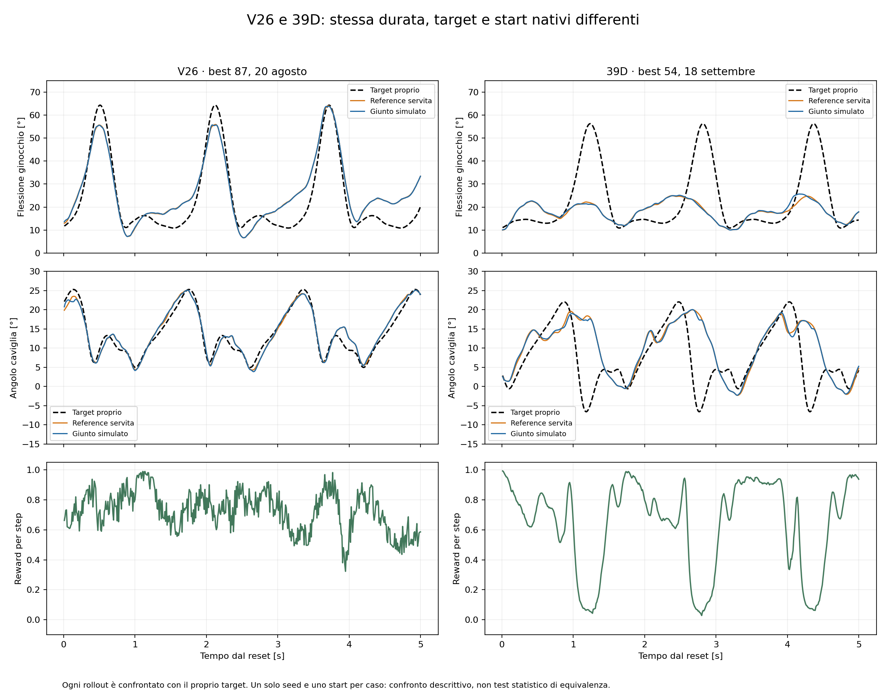

# Diagnosi del divario imitativo: 39D best54 e V26 best87

Data: 2026-09-18. Instruction check token: CMC_AGENT_OK_2026.

## Conclusione

Il rollout 39D non raggiunge la qualità imitativa del V26 del 20 agosto. Il difetto è già presente nella reference generata dalla policy: il controller SEA la segue con errori molto più piccoli dello scarto dal target. La policy attuale dipende poco dai quattro ingressi prescribed nelle osservazioni visitate. Il percorso software dei target risulta coerente, ma sono cambiate condizioni importanti dell'apprendimento: scala delle velocità target, disponibilità del clock prescritto esplicito, limitazione dei comandi e distribuzione degli start.

Questa diagnosi localizza il problema e mette in ordine le ipotesi. Non identifica ancora una singola causa sufficiente: servono esperimenti di training controllati per separare gli effetti.

## Riferimenti e perimetro

- Storico: `Trajectory Generator/runs/training/MLP_imitation_native_v26_08-20-2026_june_equiv_100iter`, best87; confermato dai report user e daily del 20 agosto. È il training **imitativo**, non il successivo ex-novo.
- Rollout storico: `Trajectory Generator/runs/rollout/MLP_imitation_native_v26_08-20-2026_june_equiv_100iter_rollout`.
- Attuale: `unified_MLP_39/runs/training/MLP39_left_phase_visible_best_to100_2026-09-18/milestone_iteration_000054/rl_module_last`.
- Rollout attuale: `unified_MLP_39/runs/rollout/MLP39_left_phase_best_iter54_center_2026-09-18`.
- Due rollout deterministici, seed123, 500 step da 10 ms. Start diversi: offset1.0 s storico, 1.956870983805102 s attuale. Target diversi per scelta dell'utente: destro periodico sfasato storico; sinistro periodico senza shift attuale.
- Ogni errore è calcolato contro **il target proprio** del rollout. Il confronto è descrittivo; un rollout per policy e un seed di training non costituiscono un test statistico di equivalenza.
- Al controllo delle curve il training attuale era arrivato a89, best ancora54. Le iterazioni70–89 hanno durata media degli episodi3.90 s nella39D contro4.94 s nello storico. Sulla lineage corrente erano stati campionati410112 step; lo storico completò100 iter con441110. Il solo confronto dei numeri54 e87 non descrive il lavoro di training già svolto.

## Misure del difetto

| Metrica sui cinque secondi | V26 best87 | 39D best54 |
|---|---:|---:|
| RMSE ginocchio actual–target |6.91°|14.21°|
| RMSE caviglia actual–target |1.46°|8.49°|
| RMSE ginocchio served–target |6.93°|14.09°|
| RMSE caviglia served–target |1.43°|8.59°|
| RMSE ginocchio actual–served |0.18°|0.75°|
| RMSE caviglia actual–served |0.28°|0.45°|
| Correlazione ginocchio actual/target |0.936|0.389|
| Correlazione caviglia actual/target |0.973|0.427|
| Escursione ginocchio richiesta |53.43°|45.36°|
| Escursione ginocchio realizzata |57.13°|15.66°|
| Penetrazione massima |14.80 mm|22.52 mm|
| Return deterministico |363.79|318.81|

Il ginocchio attuale raggiunge25.67° di flessione contro56.24° richiesti. L'escursione richiesta è inferiore a quella storica, ma la rete ne realizza soltanto circa35%. La diversa ampiezza dei prescribed non spiega questo scarto rispetto al proprio target.

L'errore si concentra nella parte60–100% della fase del target: RMSE ginocchio22.11° attuale contro4.89° storico; caviglia13.12° contro1.65°. Nella prima parte0–60%, gli errori sono4.97°/3.18° attuali contro7.91°/1.32° storici. Le fasi si riferiscono al target di ciascun caso, non a un'identica origine temporale comune.

Gli ultimi periodi HS→HS attuali sono1.559 e1.536 s. Si produce quindi una periodicità plausibile senza riprodurre la forma richiesta, soprattutto nella flessione. Escludere il primo secondo non risolve il problema: RMSE attuale15.71°/9.30° contro7.36°/1.45° storico.

## 1. I target arrivano correttamente, ma la policy attuale ne dipende poco

Sono stati caricati i checkpoint reali e riprodotte le azioni dai vettori osservati: errore massimo inferiore a8e-7 in azione normalizzata. Per ogni step, i target osservati prima dello step successivo coincidono con quelli registrati dopo lo step precedente, entro3e-8. La39D ha tutti i target visibili e i due slot clock prescritti a zero. Non emerge uno scambio di canali o uno sfasamento software di un passo.

Sonda offline: si mantengono fermi gli altri ingressi, modificando soltanto il blocco teacher. Variazione RMS della media dell'azione normalizzata:

| Intervento sugli ingressi | V26 ginocchio/caviglia | 39D ginocchio/caviglia |
|---|---:|---:|
| Quattro target azzerati |0.765 /0.525|0.015 /0.046|
| Target traslati di250 ms |1.107 /0.757|0.021 /0.060|
| Sole velocità target azzerate |0.762 /0.523|0.012 /0.015|

Il V26 usa fortemente le velocità del teacher. La39D, sulle osservazioni del rollout, dipende soprattutto da accelerazioni della reference, stato fisico e FSM. Questo è coerente con l'apprendimento di un movimento periodico poco vincolato alla forma prescribed.

Limite: le sonde congelano gli altri ingressi e possono creare osservazioni fuori distribuzione. Provano la sensibilità della policy nelle osservazioni visitate; non provano da sole perché il training abbia imparato questa dipendenza e non sono rollout con feature oscurate.

## 2. Due differenze degli ingressi meritano un test separato

Entrambi i checkpoint hanno actor39, critic88 e MLP256×256 tanh. Il summary storico elenca43 canali actor, ma gli ultimi quattro sono diagnostici esclusi dal prefisso39 effettivamente letto. Non c'è una perdita di quattro sensori rispetto all'actor storico.

- V26: velocità target in rad/s, senza divisione; clock prescritto sin/cos attivo.
- 39D: velocità target divise per10; clock sin/cos nullo.
- Il clock sinistro attuale guida correttamente il target della reward. La sua fase non è passata esplicitamente all'actor; informazione di fase rimane implicitamente nei target q/qdot e nei sensori online, questi ultimi descrivono il movimento simulato.

La scala degli ingressi qdot è un tema distinto dalla normalizzazione delle loss discussa in precedenza. Dividere per10 non è un errore matematico né elimina informazione, ma cambia il problema di ottimizzazione rispetto alla ricetta che funzionava. Nella prima proiezione della rete la componente variabile del teacher ha RMS0.033 nella39D contro0.207 nelV26. Le velocità sono inoltre i segnali da cui ilV26 dipende maggiormente per l'azione.

Non emerge una saturazione globale del primo tanh come spiegazione: frazione di attivazioni con |a|>0.99 pari a2.44% attuale contro19.62% storico. Il fatto che i target siano stati spostati di posizione nel vettore non è di per sé un errore quando la rete parte da pesi nuovi.

## 3. Lo slew cambia molto l'apprendimento, ma non basta spegnerlo nel checkpoint attuale

V26 non aveva slew limit. La39D limita gli endpoint a2.5 rad/s ginocchio e2.0 rad/s caviglia. Nel rollout deterministico il limite modifica79.2% dei comandi ginocchio e74.8% caviglia. I limiti hard successivi del governor su velocità/accelerazione/jerk non intervengono in questo rollout.

È stato riprodotto offline il solo percorso comandi→reference con la classe originale `ProstheticSegmentKinematics`, estratta dal sorgente senza modifiche. La reference registrata viene ricostruita con errore massimo1.49e-8 rad nella39D e1.11e-16 nello storico.

| Replay offline della reference | RMSE ginocchio | RMSE caviglia |
|---|---:|---:|
| Azioni39D, percorso originale |14.09°|8.59°|
| Stesse azioni39D, slew disattivato |14.48°|8.22°|
| Endpoint target sinistro ideale, slew attuale |7.04°|4.66°|
| Endpoint target sinistro ideale, slew disattivato |6.28°|4.21°|
| AzioniV26, percorso originale |6.93°|1.43°|
| Stesse azioniV26, slew2.5/2.0 introdotto |11.37°|3.35°|

Gli endpoint ideali con slew attuale producono una reference che raggiunge56.18° di flessione: il percorso non impone inevitabilmente un massimo di25°. Rimane ritardo del filtro; l'oracle qui usa soltanto il target al prossimo endpoint di10 ms, senza ottimizzare anticipazione.

La variazione dello slew peggiora una buona sequenzaV26, ma rimuoverlo dalla cattiva sequenza39D non la ripara: la differenza incide soprattutto sulla politica da apprendere. Le azioni39D decodificate raggiungono solo43.27° massimi di flessione già prima del filtro, contro80.46° dei comandiV26 che producono poi64° di reference. Questo è compatibile con una compensazione/anticipazione insufficiente.

Le deviazioni standard gaussiane medie della39D restano grandi,1.10/1.37 in azione normalizzata. Alle osservazioni del rollout, la probabilità calcolata che un campione gaussiano venga modificato dallo slew è97.06%/97.58%; entrambi i canali non modificati soltanto nello0.089% dei campioni attesi. Molti comandi diversi confluiscono quindi nello stesso incremento massimo positivo o negativo. È un meccanismo plausibile di difficoltà nell'apprendimento delle ampiezze e del timing. **Non è una frequenza misurata nei batch di training**: la distribuzione è valutata sulle osservazioni del rollout deterministico.

Questi replay non integrano la fisica, non aggiornano le osservazioni della policy e non dimostrano stabilità di un oracle fisico. Non equivalgono ad aver provato il nuovo comportamento in OpenSim.

## 4. Perché il return sembra meno grave dei grafici

Le reward sono state ricalcolate dai termini registrati e ricostruiscono entrambi i return con errore inferiore a1e-6. La media della loss imitativa actual sale da0.0275 a0.2784, circa10 volte; la served da0.0272 a0.2811. I target e le scale differiscono, perciò questi rapporti sono diagnostici e non metriche comuni di equivalenza.

La parte positiva usa sempre score razionali1/(1+wL) e blend80% served,20% actual. La39D ottiene reward media0.803 nella parte0–60% del ciclo, ma0.370 nel resto. Gli errori nei picchi sono gravi ma occupano soltanto una porzione dell'episodio; inoltre la curva dello score si appiattisce per grandi loss.

La penalità aggregata sui comandi vale61.53 punti nelV26 e7.07 nella39D. Quasi tutta la differenza è `command_rate_weight`:61.41 contro5.89 punti. Il movimento ridotto/poco variabile costa meno. Le penalità SEA di velocità/accelerazione/potenza sono invece piccole nei due rollout. Una parte del peggioramento imitativo viene quindi compensata da minori costi dei comandi, rendendo il return da solo un selettore poco informativo della fedeltà cinematica.

Le penalità aggiunte per clipping azioni, eventi invalidi, validità contatto, timeout e range articolare sono nulle nel rollout39D. Ricalcolando la stessa traiettoria39D con i coefficienti storici, il return resta318.81355. Questo esclude un loro costo diretto su questo rollout; non esclude che influenzino le traiettorie esplorate durante il training. La penetrazione contribuisce0.77 punti di penalità, non spiega il crollo dell'imitazione.

## Ordine consigliato delle prove

Mantenere il prescribed sinistro per fase e la visibilità100%, come richiesto. Il target diverso e le penalità accettate non vanno cambiati indiscriminatamente per inseguire il numero di return storico.

1. **Ablazione della scala qdot:** nuovo run con velocità target non divise per10; tutto il resto identico. È la modifica più circoscritta suggerita dalla dipendenza delV26 dalle velocità. Contratto degli ingressi esplicito e checkpoint separati.
2. **Ablazione dello slew:** un secondo run modifica soltanto i limiti degli endpoint, mantenendo la scala originale. Serve a separare il problema di esplorazione/azioni dal problema degli ingressi. Il replay mostra già che spegnerlo soltanto in inference sulbest54 non basta.
3. **Controllo del metronomo:** se necessario, esperimento con i due slot che espongono sin/cos della fase prescribed sinistra, senza shift. È una sonda sulla necessità del clock esplicito per apprendere la previsione; la successiva politica di oscuramento dovrà dichiarare anche la disponibilità di questi due ingressi.
4. Usare gli stessi tre start e seed per la valutazione delle varianti. Oltre al return, registrare RMSE per giunto, RMSE durante flessione, picco/escursione, correlazione, durata/cicli e penetrazione. La selezione del checkpoint deve mostrare queste metriche e non soltanto il return dei campioni PPO.
5. Se questi controlli non recuperano qualità, provare un oracle fisico prescribed sinistro con anticipazione controllata, per verificare la fattibilità sotto l'intero modello. Solo dopo isolare effetto multistart, FSM e termini reward, con una differenza per esperimento. Per concludere equivalenza statistica serviranno repliche con seed indipendenti e margini dichiarati.

I test1–3 non sono stati lanciati da questa analisi. Non è stato modificato il training in corso, né il runtime del simulatore o i checkpoint.

## Artefatti e riproducibilità

- `analyze.py`, `metrics.json`, `comparison.png`: metriche, decomposizione e ricalcolo reward, confronto grafico.
- `policy_input_audit.py`, `policy_input_audit.json`: checkpoint caricati, riproduzione azioni, sensibilità, scala ingressi e probabilità slew condizionata.
- `filter_replay.py`, `filter_replay.json`: replay del filtro su entrambi i trace, scenari alternativi e hash delle fonti.
- Sorgenti consultati: `unified_MLP_39/env.py`, `target_availability.py`, `reward_function.py`, `asymmetric_rl_module.py`; `osim_trj_cmc_like.py` per mapping azioni, slew, clock, osservazioni e loss; configurazioni risolte dei due run.
- Le prove sono tutte offline su artefatti locali. Il metronomo della reward, la visibilità e la ricostruzione delle azioni sono verificati; le attribuzioni alla dinamica di apprendimento rimangono ipotesi da isolare con i test sopra.
